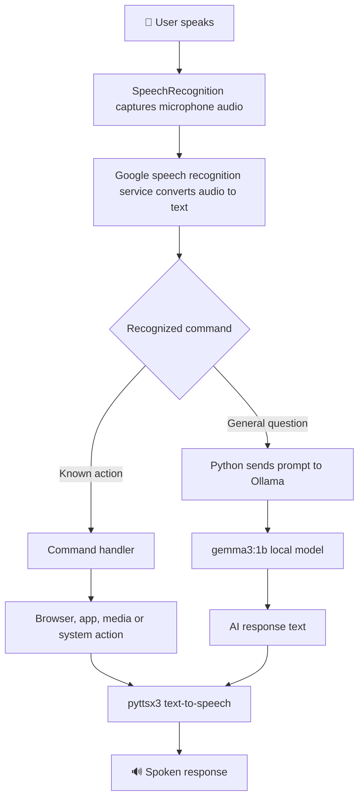

<div align="center">

# 🤖 Smarty — AI Voice Assistant

### Your personal desktop assistant powered by voice commands and a local AI model

[](https://www.python.org/)
[](https://ollama.com/)
[](https://pypi.org/project/SpeechRecognition/)
[](https://www.microsoft.com/windows)

**Smarty listens to voice commands, speaks responses, helps with everyday desktop tasks, and uses a locally running Ollama model for general questions.**

[Repository](https://github.com/Armaan-2005/Smarty---AI-Voice-Assistant) · [Getting Started](#-getting-started) · [Features](#-features) · [Troubleshooting](#-troubleshooting)

</div>

---

## 📑 Table of Contents

- [Overview](#-overview)
- [How It Works](#-how-it-works)
- [Features](#-features)
- [Project Structure](#-project-structure)
- [Technology Stack](#-technology-stack)
- [Getting Started](#-getting-started)
- [Example Voice Commands](#-example-voice-commands)
- [Configuration](#-configuration)
- [Troubleshooting](#-troubleshooting)
- [Security and Privacy](#-security-and-privacy)
- [Limitations and Future Improvements](#-limitations-and-future-improvements)
- [Author](#-author)

## 🌟 Overview

**Smarty** is a Python-based personal voice assistant built to combine voice interaction with practical desktop automation. It listens through a microphone, recognizes spoken commands, responds using text-to-speech, and uses an Ollama-hosted language model to answer general questions.

The project combines rule-based commands for predictable actions with a local language model for open-ended conversation.

### Project goals

- Interact with a desktop computer using natural voice commands.
- Provide spoken responses through text-to-speech.
- Run general AI conversations using a locally hosted Ollama model.
- Automate selected browser, application, media, and system tasks.
- Explore how speech recognition, local AI inference, and desktop automation work together.

## 🧠 How It Works



<details>
<summary><strong>Step-by-step explanation</strong></summary>

1. **Listen:** `SpeechRecognition` captures audio from the microphone.
2. **Transcribe:** `recognize_google()` converts speech into text. This recognition step requires an internet connection.
3. **Identify intent:** The application checks whether the text matches a supported command, such as opening a website or checking system performance.
4. **Execute:** Known commands call the relevant browser, keyboard, process, media, or system functions.
5. **Think:** If the command does not match a predefined action, Smarty sends the recent conversation context to Ollama.
6. **Respond:** `pyttsx3` speaks the resulting text using the Windows SAPI5 speech engine.

</details>

## ✨ Features

| Feature | What it does |
|---|---|
| 🎙️ Voice input | Listens through a microphone and recognizes spoken commands |
| 🔊 Spoken responses | Reads responses aloud using text-to-speech |
| 🧠 Local AI chat | Uses Ollama with `gemma3:1b` for general questions |
| 🌐 Website shortcuts | Opens Google, YouTube, Instagram, and WhatsApp Web |
| 🖥️ App control | Searches for applications and can close matching running processes |
| ⌨️ Voice typing | Types dictated text into the active window |
| 🎬 YouTube playback | Searches for and opens YouTube videos |
| 🎵 Spotify search | Opens Spotify search for requested music |
| 📰 News shortcut | Opens Google News |
| 🕒 Date and time | Announces the current date or time |
| 📊 System status | Reports CPU and RAM utilization |
| 🔉 Volume control | Increases, decreases, or mutes system volume |
| 👋 Exit command | Stops the assistant when a supported exit phrase is recognized |

<details>
<summary><strong>Example commands to try</strong></summary>

- “Hello Smarty”
- “What time is it?”
- “What is today's date?”
- “Open YouTube”
- “Open Google”
- “Open WhatsApp”
- “Play video [topic]”
- “Play song [song name]”
- “System status”
- “Volume up”
- “Volume down”
- “Mute”
- “Minimize”
- “Close browser”
- “Type [text to enter]”
- “Tell me about cloud computing”
- “Exit”

Exact recognition depends on how the command is spoken and the current application state. The assistant only supports the actions implemented in its command handlers.

</details>

## 📂 Project Structure

```text
Smarty---AI-Voice-Assistant/
│
├── Smarty Voice App.py   # Main application: listening, commands, AI and speech
├── requirements.txt      # Python package dependencies
├── How to Start.txt      # Setup notes and Ollama commands
└── README.md             # Project documentation
```

<details>
<summary><strong>📄 Smarty Voice App.py — Main application</strong></summary>

The main Python script contains the assistant's functionality, including:

- `listen()` — captures microphone audio and returns recognized text.
- `speak()` and `_speak_thread()` — produce spoken responses through SAPI5.
- `think()` — sends prompts to Ollama's local generate API.
- `close_app()` — searches running processes and attempts to terminate a matching process.
- `play_on_spotify()` — opens a Spotify search URL.
- Main command loop — routes recognized text to the corresponding action.

</details>

<details>
<summary><strong>📄 requirements.txt — Dependencies</strong></summary>

The repository lists these packages:

- `SpeechRecognition` — speech recognition interface.
- `pyttsx3` — text-to-speech.
- `PyAutoGUI` — keyboard and desktop automation.
- `psutil` — process and system resource information.
- `requests` — HTTP requests to Ollama.
- `pywhatkit` — YouTube playback helper.
- `PyAudio` — microphone audio input.
- `pypiwin32` — Windows integration dependencies.

Python's standard library also supplies modules such as `time`, `webbrowser`, `threading`, and `datetime`.

</details>

<details>
<summary><strong>📄 How to Start.txt — Setup notes</strong></summary>

This file includes Python version guidance and example Ollama commands. The current application code specifies `gemma3:1b` as its model. If the setup notes mention a different model, follow the model configured in the Python script or update both consistently.

</details>

## 🧰 Technology Stack

| Technology | Purpose |
|---|---|
| Python | Main application logic |
| SpeechRecognition | Microphone input and speech transcription |
| Google speech recognition | Converts recognized audio into text through an online service |
| pyttsx3 / SAPI5 | Spoken output on Windows |
| Ollama | Runs the language model locally |
| `gemma3:1b` | Language model configured in the application |
| Requests | Sends prompts to Ollama's HTTP API |
| PyAutoGUI | Keyboard shortcuts and typing automation |
| psutil | Reads CPU/RAM usage and examines running processes |
| pywhatkit | Helps open YouTube playback |
| Web browser | Opens websites and online services |

## 🚀 Getting Started

### Requirements

Before running Smarty, prepare:

- Windows, because the current code uses the SAPI5 speech engine and Windows keyboard shortcuts.
- Python 3.9, 3.10, or 3.11; Python 3.10 is suggested in the repository setup notes.
- A working microphone and speakers or headphones.
- An internet connection for Google speech recognition and online services.
- Ollama installed and running locally.
- The Ollama model `gemma3:1b` downloaded.

### 1. Clone the repository

Open Command Prompt or PowerShell:

```bash
git clone https://github.com/Armaan-2005/Smarty---AI-Voice-Assistant.git
cd Smarty---AI-Voice-Assistant
```

### 2. Create and activate a virtual environment

```powershell
py -3.10 -m venv .venv
.\.venv\Scripts\Activate.ps1
```

If PowerShell blocks script activation, use Command Prompt instead:

```bat
.venv\Scripts\activate.bat
```

### 3. Install Python dependencies

```bash
python -m pip install --upgrade pip
pip install -r requirements.txt
```

If `PyAudio` installation fails, use a compatible Python version and a compatible PyAudio package for your Windows/Python architecture.

### 4. Install and start Ollama

Install Ollama from [ollama.com](https://ollama.com/).

Download the model used by the code:

```bash
ollama pull gemma3:1b
```

Start the Ollama service if it is not already running:

```bash
ollama serve
```

If Ollama is already running as a background service, you may not need to start a second server.

Verify the model is available:

```bash
ollama list
```

Test the local model API:

```bash
curl http://localhost:11434/api/generate -d "{\"model\":\"gemma3:1b\",\"prompt\":\"Hello\",\"stream\":false}"
```

### 5. Run Smarty

In a terminal with the virtual environment activated:

```bash
python "Smarty Voice App.py"
```

Wait for the assistant's startup greeting, allow microphone access if prompted, and speak one of the supported commands.

> **Note:** The application uses `http://localhost:11434/api/generate` for Ollama. Keep Ollama running while using the assistant.

## 🗣️ Example Voice Commands

| Say | Expected action |
|---|---|
| `Hello Smarty` | Greets the user |
| `What time is it?` | Announces the current time |
| `What is the date?` | Announces the date |
| `Open YouTube` | Opens YouTube in the browser |
| `Open Google` | Opens Google in the browser |
| `Open WhatsApp` | Opens WhatsApp Web |
| `Play video cats` | Searches for and plays a YouTube video |
| `Play song [name]` | Opens Spotify search for the requested song |
| `System status` | Announces CPU and RAM utilization |
| `Volume up` | Raises the system volume |
| `Mute` | Mutes system audio |
| `Minimize` | Minimizes windows using a Windows shortcut |
| `Close browser` | Attempts to close the active browser window |
| `Tell me about AWS` | Sends the general question to Ollama |
| `Exit` | Ends the assistant loop |

Voice recognition may interpret a command differently from what was intended. Confirm the recognized text in the terminal when troubleshooting.

## ⚙️ Configuration

The following settings are defined in the Python script:

```python
OLLAMA_URL = "http://localhost:11434/api/generate"
OLLAMA_MODEL = "gemma3:1b"
```

- Change `OLLAMA_MODEL` to another model that has been downloaded in Ollama.
- Ensure the model name in the script matches the model shown by `ollama list`.
- The speech output currently uses Windows SAPI5.
- The current speech input calls Google's speech recognition service, so the application is not completely offline.

## 🛠️ Troubleshooting

<details>
<summary><strong>Smarty says it cannot connect to its AI brain</strong></summary>

1. Check whether Ollama is installed.
2. Run `ollama list` and verify `gemma3:1b` is available.
3. Check whether the Ollama service is running.
4. Test `http://localhost:11434/api/generate` locally.
5. Ensure the model name in the script matches the installed model.

</details>

<details>
<summary><strong>Microphone or PyAudio errors</strong></summary>

- Check Windows microphone permissions.
- Verify that the correct recording device is enabled.
- Install a compatible PyAudio build for the selected Python version.
- Close other applications that may be exclusively using the microphone.

</details>

<details>
<summary><strong>Smarty hears the wrong command or does not respond</strong></summary>

- Speak clearly and reduce background noise.
- Check the terminal output for the recognized phrase.
- Verify the internet connection because `recognize_google()` uses an online recognition service.
- Try one of the exact examples in the command table.

</details>

<details>
<summary><strong>Text-to-speech fails</strong></summary>

- Confirm the application is running on Windows.
- Verify Windows speech components are available.
- Check that the configured SAPI5 voice index exists on your system. Available voices can differ between computers.

</details>

<details>
<summary><strong>Voice typing enters text in the wrong place</strong></summary>

The typing feature sends keystrokes to the currently focused application. Select the intended text field first and test with harmless text before using it in other applications.

</details>

## 🔐 Security and Privacy

- Speech recognition uses an online Google recognition service; microphone audio is sent to that service for transcription.
- General AI prompts are sent to the locally running Ollama endpoint configured in the script.
- Desktop automation can type text, open websites, adjust volume, and terminate matching processes.
- Only run the assistant on a computer you control.
- Be careful when issuing commands that close applications or type into the currently focused window.
- Avoid entering passwords, private messages, or other sensitive information into voice commands.
- Review code changes before running scripts from third-party sources.

## 🚧 Limitations and Future Improvements

### Current limitations

- The current implementation targets Windows and uses SAPI5.
- Speech-to-text depends on an internet connection.
- Voice commands are matched using predefined text conditions, so recognition and phrasing affect results.
- Desktop automation depends on the active window and local application state.
- The application loop is designed for continuous listening until an exit command is recognized.

### Potential improvements

- Add a configurable wake word and push-to-talk mode.
- Improve command matching with intent classification.
- Add safer confirmation prompts before closing applications or performing sensitive actions.
- Provide a configuration file for the model, voice, and supported applications.
- Add structured logging and automated tests.
- Improve error handling and microphone/device selection.
- Explore offline speech recognition and text-to-speech options.
- Add a GUI for settings, status, and command history.

## 👨‍💻 Author

**Mohammed Armaan Bakshi**

- GitHub: [@Armaan-2005](https://github.com/Armaan-2005)
- Project: [Smarty — AI Voice Assistant](https://github.com/Armaan-2005/Smarty---AI-Voice-Assistant)

---

<div align="center">

**Built with Python, voice automation, and local AI.**

⭐ If you find this project useful, consider starring the repository.

</div>
